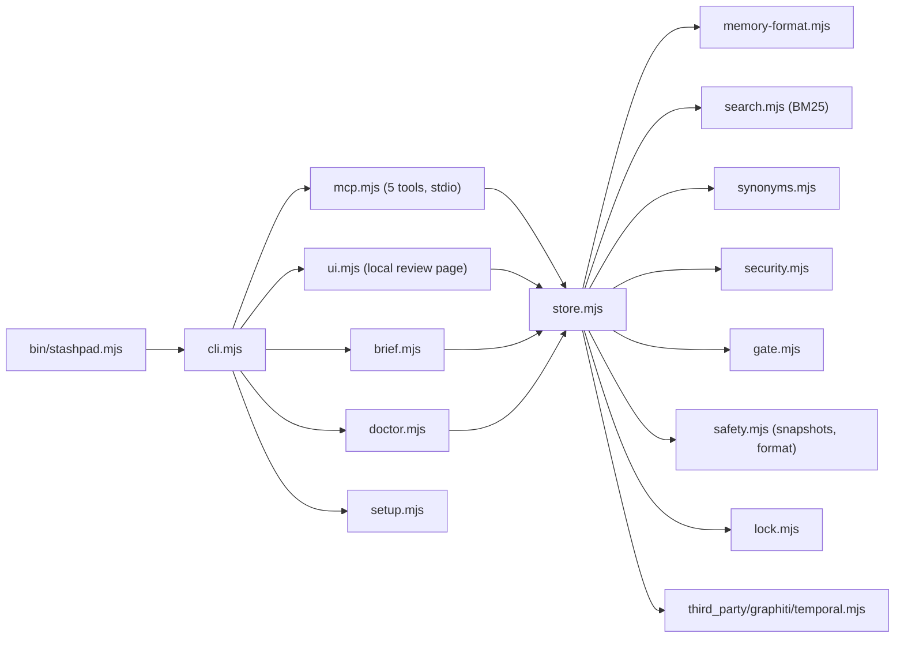

# Architecture

Stashpad is a Node 20 package with no dependencies. One entry point (`bin/stashpad.mjs`) runs the command line; the MCP server and the review page are commands of the same program. There are no cycles between modules (checked with ReversePort's dependency graph).



## Modules

| Module | Job |
|---|---|
| `store.mjs` | All reads and writes of memories, the review queue and the audit log. Every write holds the store lock. |
| `memory-format.mjs` | The fixed frontmatter: parse, render, validate. Unknown keys make a file invalid on purpose. |
| `search.mjs`, `synonyms.mjs` | BM25 ranking in plain JavaScript; synonyms count half. Computed per search, no index on disk. |
| `security.mjs` | Secret patterns, invisible characters, instruction-like text (English and Dutch), limits. |
| `gate.mjs` | Refuses short and near-copy agent notes; names related notes a save may replace. |
| `safety.mjs` | Store format marker, snapshots, restore, migrate, downgrade protection. |
| `vault.mjs`, `encrypt.mjs` | Optional encryption at rest: seal and open store files; convert a whole store. |
| `lock.mjs` | One writer at a time per store, across processes; stale locks are broken. |
| `brief.mjs` | The short session brief and the `AGENTS.md` block. |
| `doctor.mjs` | Setup and store checks with a fix per problem, plus a built-in round trip. |
| `mcp.mjs`, `contract.mjs` | The agent tools and the frozen tool contract (`docs/tool-contract.json`). |
| `ui.mjs`, `ui/` | The local review page (only this computer, per-run token, text only). |
| `importer.mjs`, `export.mjs`, `sources.mjs` | JSON Lines in and out; raw source copies. |
| `eval.mjs` | Fixed, deterministic checks and baselines (`stashpad eval`). |

## A store folder

```
<store>/
  <id>.md               one memory per file
  pending/              writes waiting for a person (<id>.md, forget-<id>.json)
  rejected/             rejected writes, kept for the record
  sources/              raw source copies (never change)
  audit.jsonl           every change, with a short content hash
  synonyms.json         optional word groups for search
  .stashpad-store.json  format marker
  .snapshots/           snapshots (daily automatic, manual, before restore and migrate)
  .stashpad.lock        only while a write is running
```

## Rules that hold everywhere

- A memory is never overwritten. A changed fact is a new memory that ends the old one.
- Agent, tool and web writes wait for a person. A person's own writes go straight in.
- Everything returned to an agent is labelled as data, not instructions.
- No network access, no model calls, no telemetry.
- Encryption is optional and off by default; when on, every data file and snapshot is sealed.
